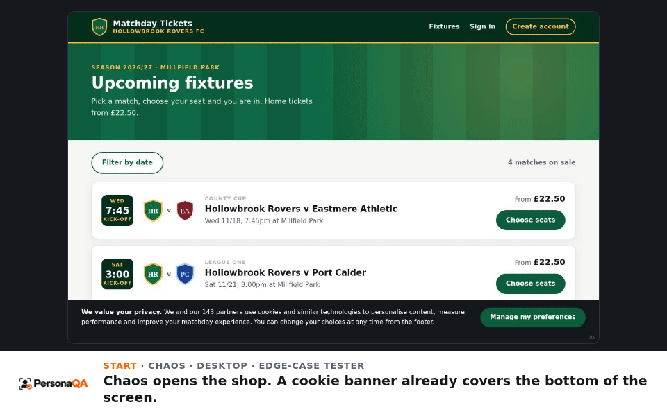
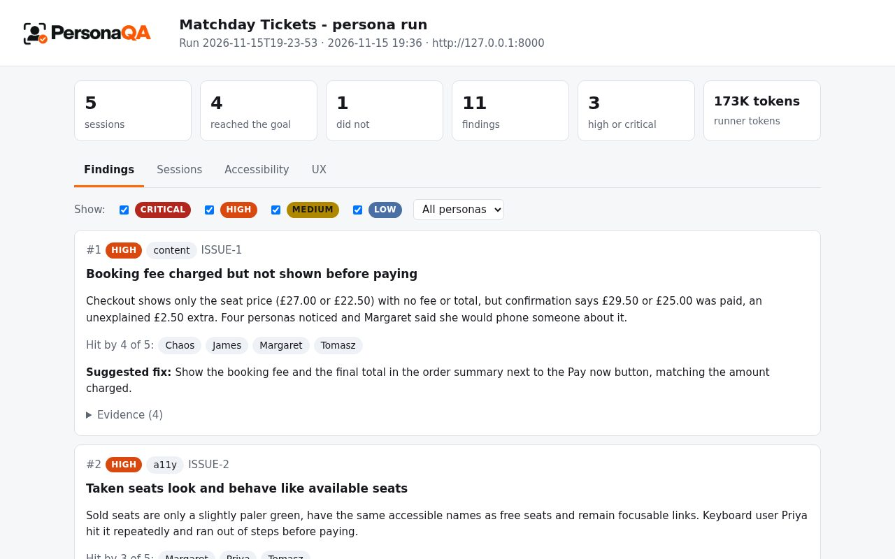

<p align="center">
  <picture>
    <source srcset="images/persona-qa-logo-light.webp" media="(prefers-color-scheme: dark)">
    
  </picture>
</p>

<p align="center"><strong>QA agents that use your app like real people.</strong></p>

PersonaQA is a Claude Code plugin that gives your app a cast of simulated users. James is 23 and on a phone with patchy 3G; Margaret reads every word on an iPad with large text; Priya never touches a mouse. Give them a mission ("buy one adult ticket for Saturday's match") and each drives a real browser as that person would, then hands back a first-person journal, issues with screenshots and Playwright traces, and a ranked report your team can act on. Confirmed findings become ordinary Playwright regression tests.

**PersonaQA finds the problems. Deterministic tests keep them fixed.**

<p align="center"></p>

## Results on a demo app

A small ticket shop was built with 15 deliberate flaws (a cookie banner that hides the Pay button on phones, a card field that truncates spaced numbers, a hidden booking fee, a date picker that traps keyboard focus, and so on), with an answer key the agents never see. One `/personaqa:run` of the five built-in personas through checkout:

| Measure | Result |
|---------|--------|
| Planted flaws found | **13 of 15** (8 of 9 usability, 5 of 6 accessibility) |
| Missed | The two flaws on pages the checkout mission never visits (sign-in and the date filter) |
| Personas | Five, run in parallel; four reached the goal, Priya (keyboard only, no visible focus) ran out of steps |
| Billed cost | About $1.50 with Sonnet, including both inspectors and the coordinator |

Margaret's journal from that run ([the full session](docs/sample-journal.md)):

> The seat page was slow, 18 seconds the first time. I tapped North Stand row A seat 1 and was sent back to the fixtures list with "Sorry, that seat is no longer available". The taken seats are only a slightly paler green, so I could not tell them apart. [...] The card number with spaces was cut off after "4242 4242 4242 4", so I retyped it without spaces. I pressed Pay now and reached "Order confirmed". It said I had paid £29.50, but I had only ever seen £27.00 and no fee or total before paying. I would want to phone someone about that extra £2.50.

Scoring is deterministic (`scripts/score.mjs` matches findings against the answer key), so model comparisons measure the cast, not the scorer.

## Why it is built this way

**The harness enforces facts; the model plays judgement.** The first prototype pointed Claude at the stock Playwright MCP with a persona prompt. It produced a believable journal and a confident "success", but the phone was just a narrow window with no throttling, the agent typed a checkout URL straight into the address bar, a single seat-map snapshot was 45,600 characters, and the success was the agent's own claim. So PersonaQA has its own browser server, and every gap became a feature ([before and after](docs/prototype-findings.md)):

| The model decides | The server enforces |
|-------------------|---------------------|
| Patience, attention, understanding, when to give up | Device, touch, viewport, locale, timezone, text size |
| What to tap and type, in character | CDP network throttling, signal drops, session expiry |
| What felt wrong, in the persona's words | Mission success (URL, text or element rules), step and time limits |
| | Domain guard, a human action set (no JavaScript, no address bar), typos at the persona's rate |

A few details that make the difference:

- **Persona agents see only the screen.** Snapshots list what is visible, with controls inline (`[e14 button "Pay now" covered by "We value your privacy..."]`). Off-screen content is summarised, so people scroll as people do, and the seat map that cost 45.6K characters costs about 2K on a phone.
- **A tap lands on whatever is on top.** Taps press screen coordinates, so a cookie banner over the Pay button takes the tap, exactly as it would for a finger.
- **Waits are facts, not instructions.** "You waited 8.5s, longer than you would normally put up with (8s)" is reported; whether James gives up is his call.
- **The text view must not see better than a person.** The smoke test exposed that Priya, keyboard only, was told which control had focus even when the site had removed every focus outline. The server now reports "focused, but nothing on screen shows it", and she finds that flaw.
- **Personas are behaviours, not caricatures.** Traits describe patience, reading, device and confidence, never assumptions about age or nationality. The persona writer is told to derive traits only from stated behaviour.

## What this demonstrates

- **A custom MCP server**: TypeScript and Playwright behind fourteen tools, with real-browser Vitest tests for every one (`server/src/`)
- **Compact, human-scale page snapshots** with diffing, overlay detection and session-wide refs: the main quality and cost lever (`server/src/snapshot-script.ts`, `server/src/snapshot.ts`)
- **A Claude Code plugin with every component type**: skills, subagents with restricted `tools:`, hooks and an inline MCP server, distributed from its own marketplace (`.claude-plugin/`, `skills/`, `agents/`, `hooks/`)
- **Deterministic code around model judgement**: planning, validation, success checks, ranking, rendering and scoring are code; merging findings and playing personas are the model's (`server/src/plan.ts`, `scripts/report.mjs`, `scripts/score.mjs`)
- **Accessibility evidence plus experience**: axe-core scans every new page state a persona reaches, and an inspector raises the severity when a persona actually suffered on the same element (`server/src/audit.ts`, `agents/a11y-inspector.md`)
- **Safety nets as hooks**: persona runners cannot use other tools, and a runner that never wrote its journal is sent back to finish (`scripts/hooks/`)

## Quick start

```
/plugin marketplace add phoenix1331/persona-qa
/plugin install personaqa@persona-qa
```

In your app's repository:

```
/personaqa:init https://staging.your-app.test
/personaqa:run james first-visit
```

The first session downloads a headless Chromium (about 290 MB) in the background. Point PersonaQA at staging, preview or local deploys only: personas fill in forms and pay with test cards. See [installation](docs/installation.md) for team setup and updates.

## Commands

| Command | Does |
|---------|------|
| `/personaqa:init [base-url]` | Scaffolds `.personaqa/` (config, a starter mission) and gitignores run output |
| `/personaqa:run [personas] [missions] [--set NAME] [--base-url URL] [--with a11y\|ux] [--no-inspectors]` | Runs the cast in parallel, then the inspectors and the coordinator |
| `/personaqa:report [run] \| confirm ISSUE-n \| dismiss ISSUE-n "reason" \| file [--yes]` | Opens a report, records triage decisions (dismissals are remembered across runs), files GitHub issues with `a11y` and `wcag-x.y.z` labels |
| `/personaqa:test ISSUE-n` | Writes a deterministic Playwright test that fails until the finding is fixed |
| `/personaqa:persona new "<description>"` | Drafts a schema-valid persona from a plain-English description |
| `/personaqa:audit [missions]` | A quick accessibility sweep with no personas |
| `/personaqa:validate` | Checks config, personas and missions and lists every problem |

Plain English works too: "get James and Margaret to try checkout with the accessibility inspector". Agents can be called directly, for example `@agent-personaqa:a11y-inspector review the last run`.

## How a run works

```
/personaqa:run james,priya checkout
  │
  ├─ plan_run            validates every file, returns persona x mission pairs and a run id
  ├─ persona-runner x N  in parallel; browser tools only
  │     └─ browser server: environment, throttling, events, success checks,
  │        ride-along axe scans, journal, issues, screenshots, trace
  ├─ a11y-inspector, ux-inspector   review the evidence, write a11y.json and ux.json
  └─ coordinator         merges issues into findings; report.mjs ranks and renders
                         summary.md (for PR comments) and report.html
```

Run output lands in `.personaqa/runs/<run id>/`: one folder per persona and mission, with `journal.md`, `issues.json`, `run.json`, `actions.log`, screenshots and `trace.zip` (`npx playwright show-trace`).

## Built-in cast

| Persona | Environment | Plays |
|---------|-------------|-------|
| James, 23 | iPhone 15, slow 3G, occasional signal drops | Skims, impatient (8s), one-handed typos, uses back often |
| Margaret, 71 | iPad, text at 150% | Reads everything, wants to know exactly what she pays |
| Priya, 34 | Desktop, keyboard only | Expects visible focus and no traps |
| Tomasz, 40 | Pixel 7, Polish locale | English as a second language: idioms and ambiguous dates slow him |
| Chaos | Desktop, session expiry | Emoji, huge inputs, empty fields, double submits, back mid-flow |

Override or extend any of them in `.personaqa/personas/` (`extends: james`), or generate new ones with `/personaqa:persona new`.

## The report

<p align="center"></p>

Every run ends with `summary.md` (for a pull request comment) and a self-contained `report.html`: findings merged across personas and ranked by severity times the number of people affected, the evidence behind each (who, which step, screenshots), each persona's journal, and Accessibility and UX tabs from the inspectors. From there, confirm or dismiss findings (dismissals are remembered), file them as GitHub issues, or turn one into a Playwright test. See [Reading the results](docs/reporting.md) for a tour.

## In CI

Example workflows run a small persona set on every pull request (posting `summary.md` as a comment) and the full cast nightly (filing GitHub issues). See [GitHub Actions](docs/github-actions.md).

## Cost and limits

- **Cost.** A persona run is a loop of look and act, so input tokens dominate. The levers are built in: compact snapshots of the visible screen only, diffs instead of repeated pages, screenshots only when asked, hard step and time limits, small sets on pull requests and the full cast nightly, and deterministic code wherever possible (axe scans, success checks and timing cost nothing in model calls).
- **Non-determinism.** The same persona takes different paths on different runs. That is the point for exploration, so never use a run as a pass/fail gate; confirmed findings become deterministic tests instead.
- **False positives.** The coordinator merges duplicates and applies explicit severity rules, and a person confirms before anything becomes a test or an issue.
- **Coverage follows missions.** Personas only find what their missions lead them to; two of the demo's misses were on pages checkout never visits.
- **Accessibility.** Automated scans and persona evidence catch only part of WCAG. They complement an audit with assistive technology users; they do not replace one.
- **Auth, CAPTCHA and 2FA.** Use stored login state and test environments with these disabled.

## Development

Prerequisites: Node.js 22 or later, Claude Code, and `osv-scanner` for the pre-commit audit (`go install github.com/google/osv-scanner/cmd/osv-scanner@latest`). Run `npm install` at the root once (installs the runtime dependencies and activates the Husky hooks) and `npm install` in `server/`.

```bash
claude --plugin-dir .                 # load this checkout as a plugin
npm --prefix server run check         # tsc, ESLint, Prettier, Vitest (real Chromium)
npm --prefix server run build         # rebuild the committed bundle in server/dist/
claude plugin validate --strict .     # manifest, marketplace and component paths
```

| Path | Holds |
|------|-------|
| `.claude-plugin/` | Plugin manifest (with the inline browser MCP server) and marketplace |
| `skills/`, `agents/`, `hooks/`, `scripts/` | Slash commands, subagents, hooks, and the report, triage, score and setup scripts |
| `server/` | The browser MCP server: `src/`, `test/` and the committed `dist/index.mjs` bundle |
| `personas/`, `schema/`, `templates/` | Built-in cast, JSON schemas (also used for editor autocomplete), report and init templates |
| `docs/`, `examples/` | Installation, CI, prototype findings, example config and workflows |

## Licence

MIT
