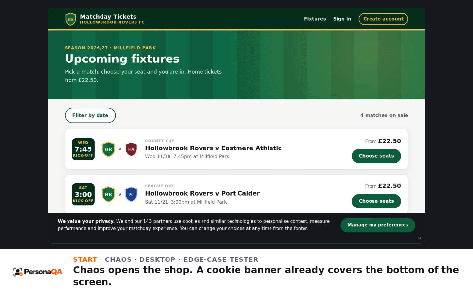

# PersonaQA
{: .fs-9 }

QA agents that use your app like real people.
{: .fs-6 .fw-300 }

[Get started](getting-started.md){: .btn .btn-primary .fs-5 .mb-4 .mb-md-0 .mr-2 }
[View on GitHub](https://github.com/phoenix1331/persona-qa){: .btn .fs-5 .mb-4 .mb-md-0 }

---

PersonaQA is a Claude Code plugin that gives your app a cast of simulated users. James is on a phone with patchy 3G; Margaret reads every word on an iPad with large text; Priya never touches a mouse. Give them a mission, such as "buy one adult ticket for Saturday's match", and each one drives a real browser as that person would. Then you get their journals, the problems they hit with screenshots, and a ranked report.

On a demo shop with 15 deliberately planted flaws, one run of the five built-in personas found 13 of them for about $1.50.

## How it fits together

| You write | PersonaQA does | You get |
|-----------|----------------|---------|
| A **mission**: a goal in plain English plus a rule that proves it was reached | Each **persona** drives a real browser with their device, network and habits enforced | A **journal** per persona, **issues** with screenshots, and a ranked **report** you can export |

## Where to go next

| I want to | Read |
|-----------|------|
| Install it and run my first persona | [Getting started](getting-started.md) |
| Describe the journeys to test | [Missions](missions.md) |
| Add my own personas or change the built-in ones | [Personas](personas.md) |
| Test pages behind a login | [Logins](authentication.md) |
| Understand and share the results | [Reading the results](reporting.md) |
| Run it on every pull request | [CI with GitHub Actions](github-actions.md) |
| Look up a config setting | [Configuration reference](configuration.md) |
| Fix something that is not working | [Troubleshooting](troubleshooting.md) |
