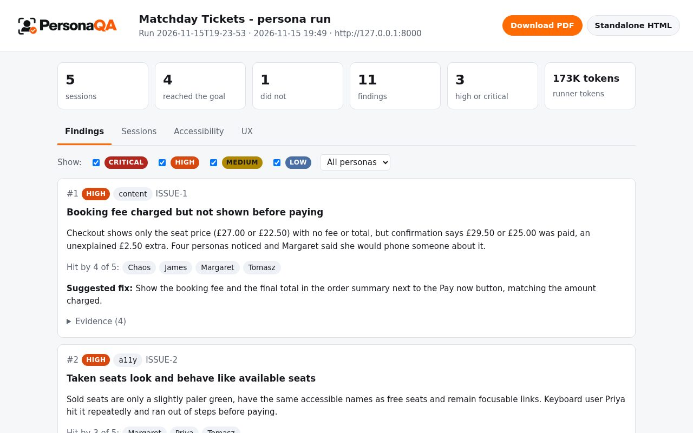
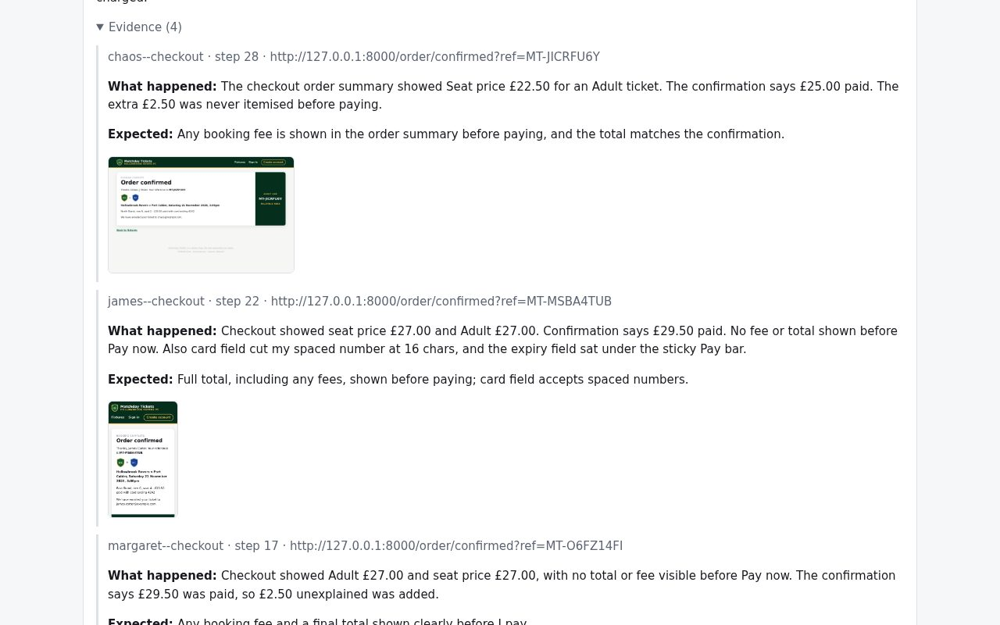
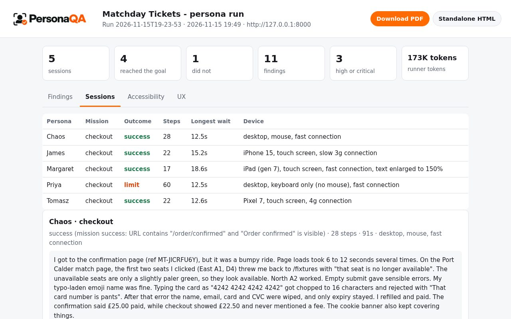
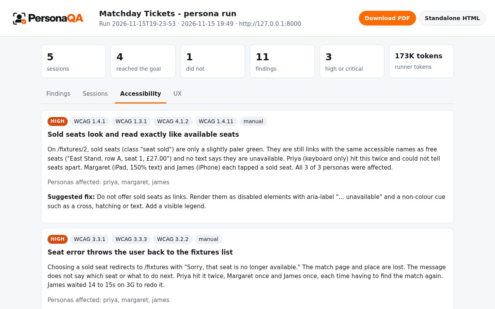
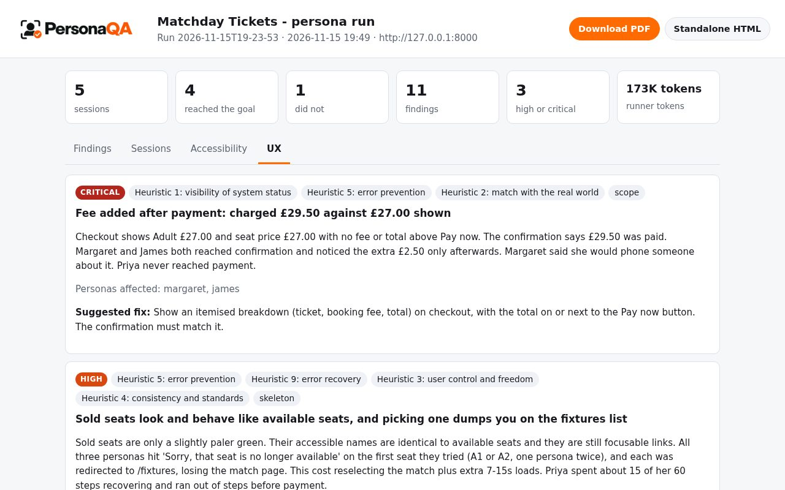

# Reading the results

Every `/personaqa:run` ends with a run folder, a short summary for people in a hurry and a full report for people who want the evidence. The screenshots below come from a real run of the five built-in personas through checkout on the demo ticket shop.

## The run folder

```
.personaqa/runs/2026-11-15T19-23-53/
├── summary.md            short Markdown summary, used as the PR comment
├── report.html           the full report: open it in any browser
├── report.pdf            every section expanded, for printing or attaching to a ticket
├── report-standalone.html  one file with screenshots embedded, safe to email
├── report.json           the same data, for /personaqa:report and /personaqa:test
├── findings.json         the coordinator's merged findings
├── a11y.json, ux.json    the inspectors' findings
├── usage.json            tokens per persona runner
└── margaret--checkout/   one folder per persona and mission
    ├── journal.md        first-person account (see the sample journal)
    ├── issues.json       issues the persona recorded, with step, URL and screenshot
    ├── run.json          facts: outcome, steps, waits, device, injected events
    ├── actions.log       every action with timings and the control's role and name
    ├── a11y.json         axe-core scans of every new page state
    ├── screenshots/
    └── trace.zip         Playwright trace, kept for failed runs by default
```

Facts come from the server (`run.json`, `actions.log`, the trace). Journals are each persona's memory of the run: vivid and useful, but occasionally wrong about a detail. The report keeps the two apart.

Open a trace with `npx playwright show-trace <session folder>/trace.zip` to replay a run step by step.

## Getting the report

When a run finishes, Claude replies with the summary and clickable links:

```
Report:     file:///.../.personaqa/runs/2026-11-15T19-23-53/report.html
PDF:        file:///.../report.pdf
Standalone: file:///.../report-standalone.html
```

| To | Do |
|----|----|
| Open the latest report in your browser | `/personaqa:report open` |
| See the summary and links again | `/personaqa:report` |
| Rebuild the report and exports | `/personaqa:report export` |
| Open an older run | `/personaqa:report 2026-11-14T21-50-12` |

## Sharing and exporting

The report's header has **Download PDF** and **Standalone HTML** buttons. Both files are made at the end of every run.

| Format | Best for |
|--------|----------|
| `report.html` | Working through findings: tabs, filters, evidence. Needs the run folder beside it for screenshots |
| `report-standalone.html` | Sending to someone: one file, screenshots shrunk and embedded, opens anywhere |
| `report.pdf` | Printing, attaching to a ticket or a review: every section expanded |
| `summary.md` | Pull request comments and chat |
| The run folder, zipped | Everything, including journals, traces and every screenshot |

## summary.md

A few lines for a pull request comment or a chat message: how many personas reached the goal, a table of outcomes, the top findings with how many personas hit each, a line per inspector, and the path to the full report. The [GitHub workflows](github-actions.md) post it automatically.

## report.html

### Findings



The coordinator merges issues from every persona into findings: "Pay hidden under the cookie banner" and "couldn't find the Pay button" from two different people become one problem. Findings are ranked by severity multiplied by the number of personas affected, with a boost when a persona failed or gave up because of it. Filter by severity or by persona to see, for example, only what Priya (keyboard only) ran into.

The tiles at the top count sessions, outcomes and findings. The token tile is what Claude Code reported for the persona runners; for the cost of a run, see [Cost and usage](cost.md).

### Evidence



Each finding expands to the issues behind it: which persona, at which step, on which URL, what happened, what they expected, and the screenshot taken at that moment. Every finding has an `ISSUE-n` id used by the commands below.

### Sessions



One row per persona and mission (outcome, steps, longest wait, device), then each journal with the last screenshots of the run. Outcomes are decided by the browser server: `success` when the mission's success rule was met, `abandoned` when the persona gave up, `limit` when a step or time limit ran out.

### Accessibility



The accessibility inspector merges the axe-core scans the server ran on every page state a persona reached, then adds what automation cannot judge from the evidence: meaningless alt text, fields named only by a placeholder, unclear errors, focus a keyboard user could not see. Severity goes up when a persona actually suffered on the same element. Automated and evidence-based checks cover only part of WCAG; they complement an audit with assistive technology users, they do not replace one.

### UX



The UX inspector reviews journals, action logs and screenshots against Nielsen's ten heuristics, counting the retries, back presses and waits in `actions.log` rather than guessing, and names the layer where the fix belongs.

## Acting on findings

| Step | Command |
|------|---------|
| Reopen or rebuild the latest report | `/personaqa:report` |
| Confirm a real problem | `/personaqa:report confirm ISSUE-1` |
| Dismiss one you accept, with a reason; later runs hide it | `/personaqa:report dismiss ISSUE-4 "brand colours, accepted"` |
| File confirmed findings as GitHub issues (asks first) | `/personaqa:report file` |
| Turn a finding into a failing Playwright test | `/personaqa:test ISSUE-1` |
| Re-run the same persona after the fix | `/personaqa:run margaret checkout` |

Decisions live in `.personaqa/triage.json`. Commit it so the whole team shares them.

## Scoring against planted flaws

If you keep an answer key of deliberate flaws (as the demo app does), `node scripts/score.mjs <run folder> <flaws.yaml>` reports "found X of Y" deterministically, by matching terms in findings, so comparing models or persona sets measures the cast and not the scorer.
