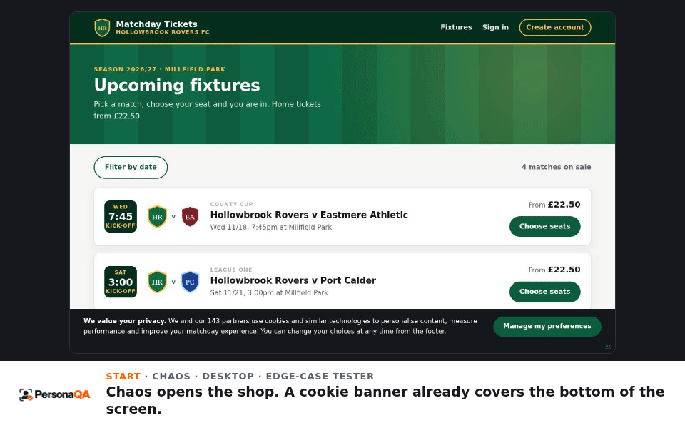

# Sample run: Margaret on checkout

One session folder from a real run of the five built-in personas against the demo ticket shop (`/personaqa:run james,margaret,priya,tomasz,chaos checkout`). Everything below was written by PersonaQA: the journal by the persona agent, the table and issues by the browser server.



## journal.md

### Margaret - checkout

| | |
|-|-|
| Persona | Margaret, 71 (`margaret`) |
| Device | iPad (gen 7), touch screen, fast connection, text enlarged to 150% |
| Mission | Buy one adult ticket for Saturday's match and get to the confirmation page. |
| Outcome | **success** (mission success: URL contains "/order/confirmed" and "Order confirmed" is visible) |
| Steps | 13 |
| Longest wait | 18.5s |
| Issues recorded | 3 |

#### Journal

I accepted the cookie banner, which covered the Saturday match link, and chose Hollowbrook Rovers v Port Calder on Saturday 21st. The seat page took 18 seconds to load. The first seat I chose, row A seat 1, was said to be unavailable even though the map showed it as available, and I was sent back to the fixtures list. I went back in, chose row B seat 5, and Adult was already selected at £27.00. I entered my name and email. My card number, typed with spaces, was cut off after 16 characters, so I retyped it without spaces. The CVC box has no proper label. The page showed no total before I pressed Pay now. The confirmation then said £29.50 paid, which is £2.50 more than the £27.00 I saw, and I am not happy about that. I did reach the confirmation page, reference MT-ESDJO9RL.

## issues.json

Recorded by Margaret as they happened; the server added the step, URL and screenshot.

**medium** · step 3 · Seat offered as available is rejected, sent to fixtures

- What happened: On the seat page, East Stand row A seat 1 was listed as available (£27.00). Tapping it sent me back to the fixtures list with "Sorry, that seat is no longer available." The seat page also took 18.5s to load.
- Expected: Unavailable seats marked as such, and on failure stay on the seat page so I can choose another.

**medium** · step 12 · Card number field cuts off spaced number; CVC unlabelled

- What happened: Typing the card as written, 4242 4242 4242 4242, left only "4242 4242 4242 4" in the field. I had to retype without spaces. The CVC box has only a placeholder and no label.
- Expected: Spaces accepted in card number and the full number kept. Visible label on CVC.

**high** · step 13 · Charged £29.50 but ticket shown as £27.00 with no fee disclosed

- What happened: Checkout showed Adult - £27.00 and no total or fee. The confirmation says £29.50 paid, £2.50 more than I was shown.
- Expected: Total including any booking fee shown before Pay now.


## actions.log (excerpt)

Every action with how long the page took to respond, and the control's role and name as Margaret saw it. These lines are what `/personaqa:test` turns into Playwright locators.

```
+   5.0s  step   1  tap e11 link "ok" (0.3s) http://127.0.0.1:8000/fixtures
+  25.0s  step   2  tap e7 link "Choose seats for Hollowbrook Rovers v Port Calder" (18.5s) http://127.0.0.1:8000/fixtures/2
+  29.4s  step   3  tap e17 link "1" (0.5s) http://127.0.0.1:8000/fixtures
+  32.9s  step   3  issue margaret-checkout-1 medium: Seat offered as available is rejected, sent to fixtures
+  39.6s  step   4  tap e263 link "Choose seats for Hollowbrook Rovers v Port Calder" (6.4s) http://127.0.0.1:8000/fixtures/2
+  42.2s  step   5  tap e287 link "5" (0.4s) http://127.0.0.1:8000/checkout?seat=377
+  45.1s  step   6  type e519 textbox "Full name" "Margaret Hughes" (0.6s) http://127.0.0.1:8000/checkout?seat=377
+  46.2s  step   7  type e520 textbox "Email address" "margaret.hughes@example.com" (0.8s) http://127.0.0.1:8000/checkout?seat=377
+  50.4s  step   9  type e521 textbox "Card number" "4242 4242 4242 4242" (0.7s) http://127.0.0.1:8000/checkout?seat=377
+  51.1s  step  10  type e522 textbox "Expiry date (MM/YY)" "12/30" (0.4s) http://127.0.0.1:8000/checkout?seat=377
+  51.8s  step  11  type e523 textbox (no name) "123" (0.4s) http://127.0.0.1:8000/checkout?seat=377
+  54.3s  step  12  type e521 textbox "Card number" "4242424242424242" (0.7s) http://127.0.0.1:8000/checkout?seat=377
```

The same run produced `run.json` (facts for the coordinator), `a11y.json` (five axe-core scans with page outlines) and a screenshot after every action. The coordinator merged Margaret's issues with the other personas' into the ranked findings in `report.html`.
