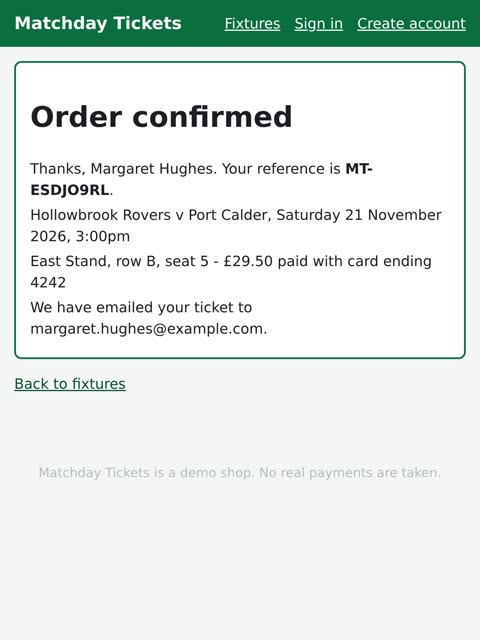

# Sample run: Margaret on checkout

One session folder from a real run of the five built-in personas against the demo ticket shop (`/personaqa:run james,margaret,priya,tomasz,chaos checkout`). Everything below was written by PersonaQA: the journal by the persona agent, the table, timings and screenshots by the browser server. For a walkthrough of another persona's run and the report, see the [walkthrough on the home page](index.md).

## journal.md

### Margaret - checkout

| | |
|-|-|
| Persona | Margaret, 71 (`margaret`) |
| Device | iPad (gen 7), touch screen, fast connection, text enlarged to 150% |
| Mission | Buy one adult ticket for Saturday's match and get to the confirmation page. |
| Outcome | **success** (mission success: URL contains "/order/confirmed" and "Order confirmed" is visible) |
| Steps | 17 |
| Longest wait | 18.6s |
| Issues recorded | 3 |

#### Journal

I accepted the cookie banner and chose Saturday's match, Port Calder on 21 November. The seat page was slow, 18 seconds the first time. I tapped North Stand row A seat 1 and was sent back to the fixtures list with "Sorry, that seat is no longer available". The taken seats are only a slightly paler green, so I could not tell them apart. I went back in and chose East Stand row A seat 2. Checkout had Adult £27.00 selected. I typed my details. The card number with spaces was cut off after "4242 4242 4242 4", so I retyped it without spaces. I pressed Pay now and reached "Order confirmed". It said I had paid £29.50, but I had only ever seen £27.00 and no fee or total before paying. I would want to phone someone about that extra £2.50.

## issues.json

Recorded by Margaret as they happened; the server added the step, URL and screenshot.

**medium** · step 8 · Unavailable seats only slightly paler green; picking one drops you to fixtures

- What happened: On the seat map, taken seats are a slightly lighter green than available ones, with no label or text. I tapped North Stand row A seat 1 and was sent back to the fixtures list with "Sorry, that seat is no longer available", losing my place and having to reselect the match.
- Expected: Clear distinction for unavailable seats (greyed, crossed out, labelled), and an error shown on the seat page so I can pick another seat.

**low** · step 16 · Card number field cuts off input when typed with spaces

- What happened: Typing the card number as printed, "4242 4242 4242 4242", left only "4242 4242 4242 4" in the box, silently dropping the last digits. I had to retype without spaces.
- Expected: Field accepts spaces (or auto-formats) and keeps all 16 digits.

**high** · step 17 · Charged £29.50 though checkout showed £27.00 seat price

- What happened: Checkout showed Adult £27.00 and seat price £27.00, with no total or fee visible before Pay now. The confirmation says £29.50 was paid, so £2.50 unexplained was added.
- Expected: Any booking fee and a final total shown clearly before I pay.



## actions.log (excerpt)

Every action with how long the page took to respond, and the control's role and name as Margaret saw it. These lines are what `/personaqa:test` turns into Playwright locators.

```
+   6.0s  step   1  tap e11 link "ok" (0.3s) http://127.0.0.1:8000/fixtures
+  27.9s  step   3  tap e7 link "Choose seats for Hollowbrook Rovers v Port Calder" (18.6s) http://127.0.0.1:8000/fixtures/2
+  33.4s  step   5  tap e77 link "1" (0.4s) http://127.0.0.1:8000/fixtures
+  44.4s  step   7  tap e263 link "Choose seats for Hollowbrook Rovers v Port Calder" (6.5s) http://127.0.0.1:8000/fixtures/2
+  51.1s  step   8  issue margaret-checkout-1 medium: Unavailable seats only slightly paler green; picking one drops you to fixtures
+  57.1s  step   9  tap e272 link "2" (5.9s) http://127.0.0.1:8000/checkout?seat=362
+  61.8s  step  11  type e519 textbox "Full name" "Margaret Ellis" (0.6s) http://127.0.0.1:8000/checkout?seat=362
+  62.9s  step  12  type e520 textbox "Email address" "margaret.ellis@example.com" (0.8s) http://127.0.0.1:8000/checkout?seat=362
+  63.9s  step  13  type e521 textbox "Card number" "4242 4242 4242 4242" (0.7s) http://127.0.0.1:8000/checkout?seat=362
+  64.6s  step  14  type e522 textbox "Expiry date (MM/YY)" "12/30" (0.4s) http://127.0.0.1:8000/checkout?seat=362
+  65.2s  step  15  type e523 textbox (no name) "123" (0.4s) http://127.0.0.1:8000/checkout?seat=362
+  67.3s  step  16  type e521 textbox "Card number" "4242424242424242" (0.7s) http://127.0.0.1:8000/checkout?seat=362
+  69.7s  step  16  issue margaret-checkout-2 low: Card number field cuts off input when typed with spaces
+  76.0s  step  17  tap e524 button "Pay now" (6.1s) http://127.0.0.1:8000/order/confirmed?ref=MT-O6FZ14FI
```

The same session folder also holds `run.json` (facts for the coordinator), `a11y.json` (axe-core scans of every new page state, with page outlines) and a screenshot after every action. See [Reading the results](reporting.md) for what happens to it next.
